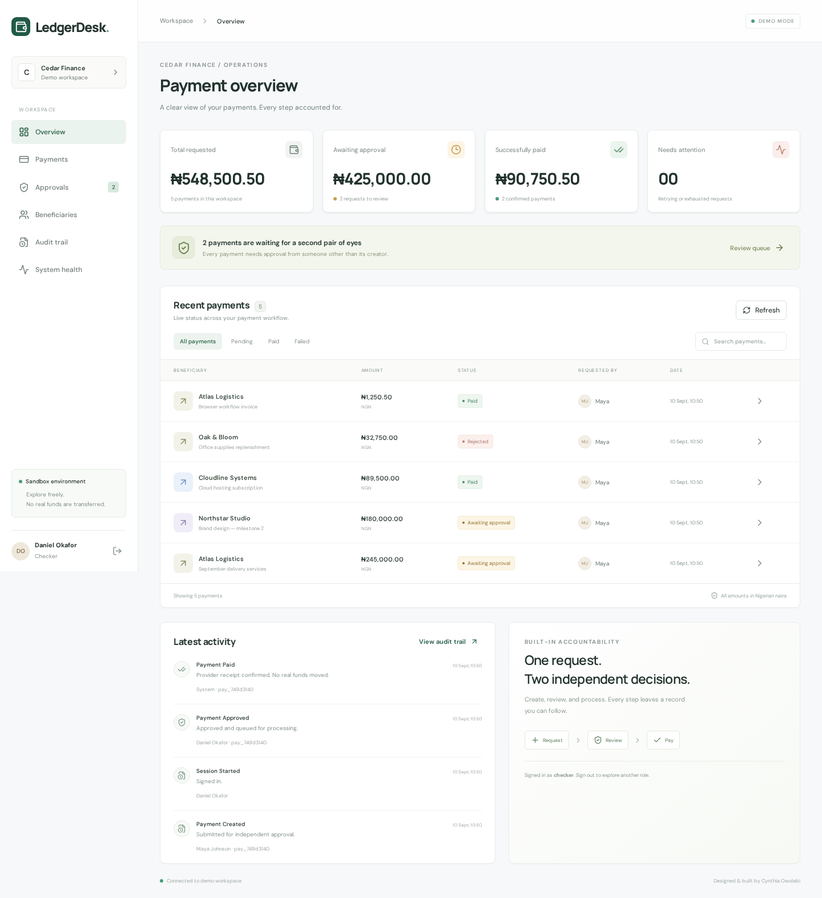
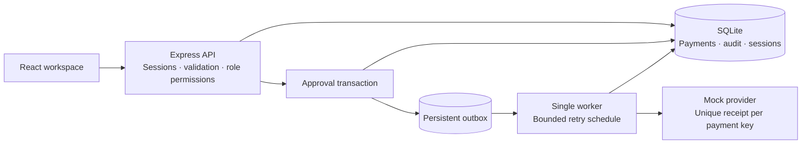
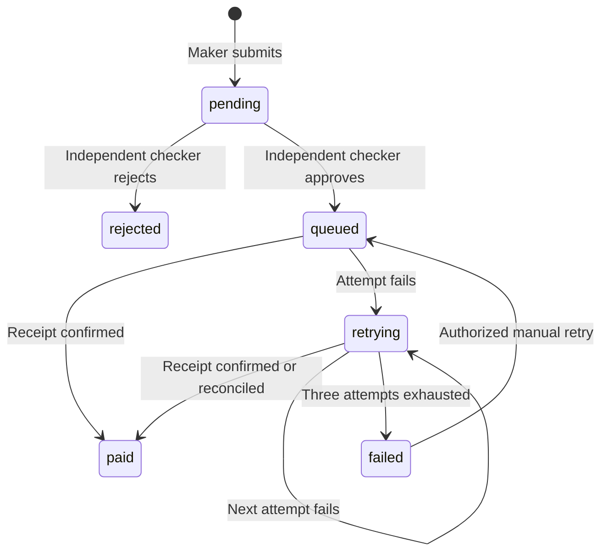

# LedgerDesk · Payment Operations Console

An original full stack portfolio project by **Cynthia Owolabi**: a payment operations workspace with independent approvals, an auditable lifecycle, and recovery from ambiguous provider failures.

Built to demonstrate engineering patterns relevant to fintech operations. All users, companies, accounts, and transactions are synthetic. The provider is simulated; no real funds move. This is not employer code or a reconstruction of an employer system.



## Why this project

An approval button is easy. The interesting part is what happens when a creator approves their own request, two reviewers act on stale data, a client retries after a lost response, or a provider accepts a payment and then times out.

LedgerDesk makes these cases visible and testable:

- Server-enforced maker, checker, admin, and viewer permissions.
- Independent approval, including for requests created by admins.
- Integer minor units for NGN amounts; no floating-point payment arithmetic.
- Idempotent creation with payload-conflict detection.
- Atomic approval, audit event, and persistent outbox insertion.
- Bounded retries and a provider simulator that can accept a payment before timing out.
- Reconciliation using a stable payment key and a unique simulated provider receipt.
- Audit records protected against updates and deletions by SQLite triggers.
- Responsive dashboard, payment review, beneficiary directory, and system-health controls.

## Run locally

Requires **Node.js 22.13+ on the 22.x line, or Node.js 24+**, and npm. Node 22 prints an experimental warning for its built-in SQLite API.

```sh
npm ci
npm run dev
```

Open **http://127.0.0.1:5173**. The API listens on port 3001 and Vite proxies `/api` to it. On first startup the app creates a SQLite database in `data/ledgerdesk.db` and seeds four users, four beneficiaries, and example payments.

For the compiled frontend served by the API:

```sh
npm run build
npm start
```

Open **http://127.0.0.1:3001**. No external database or payment credentials are needed.

### Demo accounts

Default local password for all accounts: `LedgerDemo!2026`.

| Account                  | Role    | Permissions                                                         |
| ------------------------ | ------- | ------------------------------------------------------------------- |
| `maya@ledgerdesk.demo`   | Maker   | Create and view payments                                            |
| `daniel@ledgerdesk.demo` | Checker | Review others' requests and retry exhausted payments                |
| `amara@ledgerdesk.demo`  | Admin   | Create, review others' requests, retry, and configure the simulator |
| `alex@ledgerdesk.demo`   | Viewer  | Read workspace data                                                 |

The role shortcuts on the login page select an email; they do not bypass authentication. Sign out to switch roles.

## Five-minute walkthrough

1. Sign in as **Maya**, select **New payment**, choose a beneficiary, and submit an amount and reference.
2. Open the payment. There is no self-approval control, and the API independently rejects unauthorized review.
3. Sign out and sign in as **Daniel**. Open the request under **Approvals**, then approve it. The worker confirms it within a few seconds.
4. Open **Audit trail** to see creation, approval, and provider confirmation with their actors.
5. Sign in as **Amara** and set **System health → Simulator behavior** to **Accept, then time out**. Approve a pending request created by Maya. The first attempt records provider acceptance but reports a timeout. After five seconds, a retry reconciles the existing receipt and marks it paid.
6. Set the provider to **Unavailable** and approve another request. It attempts three times, waiting five and then ten seconds. Restore **Healthy** and use **Retry payment** on the exhausted request to recover.

## Architecture





Read [the design decisions and failure analysis](docs/ARCHITECTURE.md) and [the API contract](docs/API.md).

## Validation

```sh
npm test
npm run build
npx playwright install chromium
npm run test:e2e
```

The domain/API suite covers integer money validation, idempotency conflicts, role enforcement, self-approval, stale review, transaction rollback, rejection, timeout reconciliation, retry exhaustion, immutable audit operations, session revocation/expiry, and recovery after restart.

The browser test signs in as a maker, creates a payment, verifies self-approval is unavailable, switches to a checker, approves, and waits for confirmation. It also checks mobile viewport overflow and navigation. Screenshots are generated in `docs/`.

## Configuration

| Variable             | Default                   | Purpose                                                      |
| -------------------- | ------------------------- | ------------------------------------------------------------ |
| `PORT`               | `3001`                    | API and compiled site port                                   |
| `HOST`               | `127.0.0.1`               | Bind address                                                 |
| `DB_PATH`            | `data/ledgerdesk.db`      | Persistent database, or `:memory:` for disposable runs       |
| `DEMO_PASSWORD`      | Local demo password above | Password used **only when seeding a new database**           |
| `SEED_EXAMPLES`      | `true`                    | Set `false` to seed users and beneficiaries without payments |
| `SIMULATOR_CONTROLS` | `true`                    | Set `false` to disable changes to simulator behavior         |
| `COOKIE_SECURE`      | `false`                   | Set `true` behind HTTPS so session cookies are HTTPS-only    |
| `NODE_ENV`           | Unset                     | `production` requires an explicit `DEMO_PASSWORD`            |

For a hosted demo, use HTTPS, `COOKIE_SECURE=true`, a persistent volume for `DB_PATH`, and one application process. This repository does not include a hosted deployment. SQLite is deliberately chosen for a reproducible single-process demo; production payment processing needs a separate operational design.

## Scope and limits

- One workspace, one Node process, one synchronous worker. No multi-tenant isolation or distributed worker leases.
- The mock provider's receipt table is in the same database for reproducibility. Its idempotency behavior is simulated, not proof of guarantees from a real bank.
- No actual account balances, ledger postings, settlement, FX, refunds, or payment-provider integration.
- Audit triggers prevent normal SQL updates/deletes, not tampering by a database administrator. There is no external immutable log store.
- Beneficiaries are seeded and read-only. The activity screen shows the latest 500 events.
- Public demo credentials, basic in-memory login throttling, and local session management are for demonstration. There is no SSO, MFA, credential recovery, or invitation workflow.
- Historical employment metrics are not benchmarks for this application. No performance claims are made without measurement.

## Author

[Cynthia Owolabi](https://github.com/adebolaowolabi32) · [Portfolio](https://adebolaowolabi32.github.io/) · [LinkedIn](https://www.linkedin.com/in/adebolaowolabi)
