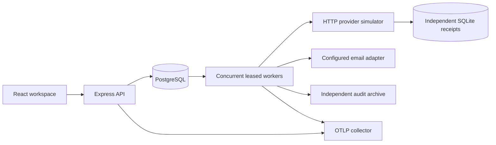
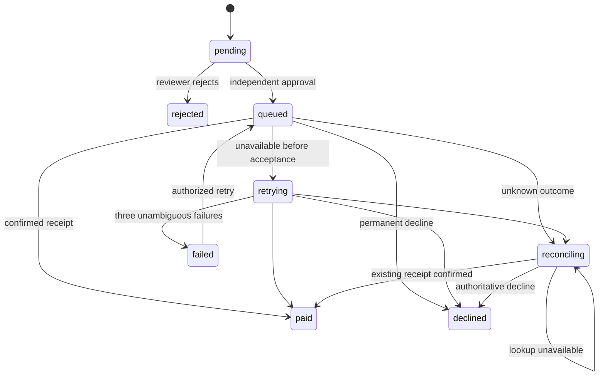

# Architecture

The API and worker share versioned PostgreSQL tables. A transaction commits payment approval, its append-only audit event, and a due job. Workers claim with `FOR UPDATE SKIP LOCKED`, commit the lease, then make network calls outside the transaction. Completion locks the payment and job and checks owner, claim version, expiry, and terminal state before changing them. Stale outcomes remain in history; payment updates require a valid current claim.

A missing transfer from an authoritative lookup permits a new submit **with the same provider idempotency key**. Expired claims are treated as uncertain even if the previous worker never recorded an outcome. This covers a crash after remote acceptance but before local completion. Leases fence local writes; provider idempotency handles overlapping remote submissions. Network submissions can repeat; the provider deduplicates them using the stable key.

Signed callbacks verify the original bytes, timestamp, and HMAC before parsing. Event IDs deduplicate delivery. Payment/amount matching and terminal-state checks prevent mismatched or reordered events from overwriting results. Provider credentials and callback signing secrets are separate.

## Data ownership

Organizations own memberships, beneficiaries, payments, jobs, audit records, and attempt events. Users and credentials are global; a session selects one active membership. Every public Store operation rechecks current membership, including direct service calls. Composite organization/resource foreign keys prevent linking payment history or beneficiaries to another workspace.

Request idempotency is scoped to organization + actor + key. Payment-list cursors bind organization, filters, and sort order; tie-breaking uses the payment ID. Audit and attempt pages use their unique IDs and payment-specific indexes. Pages reflect current state: concurrent state changes may move records between filters. Summary aggregates cover the whole organization.

## Identity and observability

Passwords use asynchronous scrypt. Session and one-time tokens are stored hashed. Invitations and recovery instructions enter an encrypted delivery outbox in the same transaction as token issuance. Delivery claims are leased and remote retries use stable keys. Password rotation/recovery revokes every active session; membership changes affect subsequent authorization.

API request IDs appear in response headers, structured logs, and audit events. Approval trace context persists with the payment and is restored for each processing attempt. HTTP provider calls inject the active trace context. Each provider operation writes a started event before network I/O and a separate outcome event afterward; an interrupted process leaves its started event visible. The test suite verifies the same trace ID across approval, timeout, and reconciliation.

External audit export advances its checkpoint only after durable receiver acknowledgement. A short table SHARE lock selects a committed prefix, avoiding sequence-ID commit-order gaps; the HTTP request runs after the database transaction closes. The receiver must deduplicate retries and enforce retention independently. Large deployments should replace this periodic batch mechanism with a dedicated archival pipeline if its write-lock cost becomes material.
